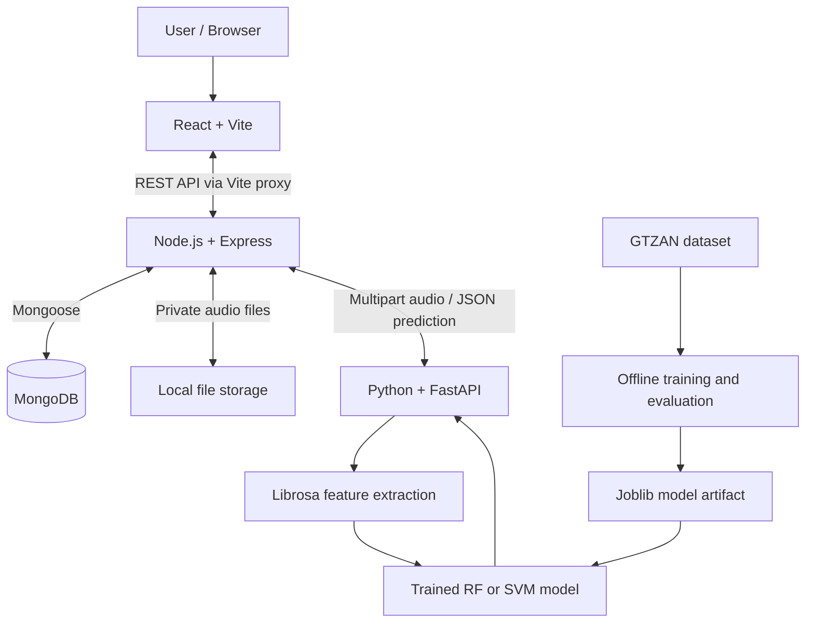
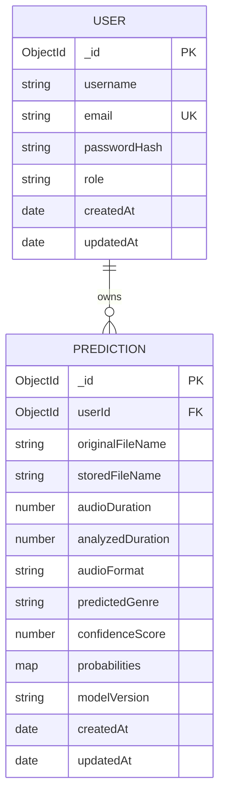

# GenreLab(mgc) — AI-Powered Music Genre Classifier

**A full-stack music analysis platform built with MERN, Python and Machine Learning.**


## Table of contents

- [Features](#features)
- [Supported genres](#supported-genres)
- [Technology stack](#technology-stack)
- [System architecture](#system-architecture)
- [Project structure](#project-structure)
- [Getting started](#getting-started)
- [Machine learning pipeline](#machine-learning-pipeline)
- [Database design](#database-design)
- [API reference](#api-reference)
- [Testing](#testing)
- [Troubleshooting](#troubleshooting)
- [Team responsibilities](#team-responsibilities)
- [Security and deployment](#security-and-deployment)
- [Roadmap and limitations](#roadmap-and-limitations)
- [Documentation and references](#documentation-and-references)

## Features

| Web application                              | AI/ML and backend                                    |
| -------------------------------------------- | ---------------------------------------------------- |
| Responsive, dark-themed landing page         | Real audio feature extraction with Librosa           |
| User registration, login and logout          | Random Forest and Support Vector Machine             |
| Protected user dashboard                     | Model comparison and automatic artifact export       |
| Drag-and-drop audio upload and preview       | FastAPI prediction service and model status          |
| Predicted genre and confidence visualization | JWT authentication with HttpOnly cookies             |
| Probability distribution across ten genres   | MongoDB persistence and user-specific access         |
| Prediction history, playback and deletion    | Audio validation, private storage and error handling |
| Genre distribution and prediction statistics | Dataset audit, evaluation reports and test scripts   |

**Input constraints:** MP3 or WAV, maximum 25 MiB (26,214,400 bytes), at least five seconds of valid, non-silent audio. The model analyzes up to the first 30 seconds. MP3 decoding depends on platform support in SoundFile/libsndfile.

## Supported genres

| Genre     | API key     | Genre  | API key  |
| --------- | ----------- | ------ | -------- |
| Blues     | `blues`     | Jazz   | `jazz`   |
| Classical | `classical` | Metal  | `metal`  |
| Country   | `country`   | Pop    | `pop`    |
| Disco     | `disco`     | Reggae | `reggae` |
| Hip-Hop   | `hiphop`    | Rock   | `rock`   |

## Technology stack

| Layer               | Technologies                                                |
| ------------------- | ----------------------------------------------------------- |
| Frontend            | React 18, Vite, JavaScript, Tailwind CSS                    |
| Routing and UI      | React Router DOM, Lucide React, Recharts                    |
| HTTP client         | Axios                                                       |
| Backend             | Node.js, Express, Multer, FormData                          |
| Database            | MongoDB, Mongoose                                           |
| Authentication      | JSON Web Tokens, bcryptjs, HttpOnly cookies                 |
| ML service          | Python 3.11, FastAPI, Uvicorn                               |
| Audio processing    | Librosa, SoundFile, NumPy                                   |
| Machine learning    | Scikit-learn, Random Forest, RBF SVM                        |
| Data and evaluation | Pandas (declared dependency), Matplotlib, Seaborn           |
| Model serialization | Joblib                                                      |
| Testing             | Node.js test runner, Pytest, HTTPX, end-to-end smoke script |

## System architecture



### Prediction workflow

1. An authenticated user selects an audio file in the React application.
2. Express validates the request and stores the upload under a generated private filename.
3. Express forwards the audio as multipart form data to FastAPI.
4. Python validates and decodes the file, converts it to mono, resamples it and extracts a 75-dimensional feature vector.
5. The trained classifier generates probabilities for all ten supported genres.
6. FastAPI returns the highest-probability genre, confidence, durations and model version.
7. Express validates the prediction response and saves its metadata in MongoDB.
8. React displays the result, probability chart and updated history.

Model training is an offline process. The web application performs inference using an already trained artifact; it does not retrain the model for each upload.

## Project structure

```text
music-genre-classifier/
├── frontend/
│   ├── src/
│   │   ├── components/       # Shared UI and result visualization
│   │   ├── context/          # Authentication state
│   │   ├── pages/            # Public pages and authenticated workspace
│   │   ├── services/         # Axios API client
│   │   ├── main.jsx          # Application entry point and routes
│   │   └── index.css         # Styles
│   ├── index.html
│   ├── vite.config.js
│   ├── tailwind.config.js
│   ├── postcss.config.js
│   └── package.json
├── backend/
│   ├── src/
│   │   ├── app.js            # Express routes and middleware
│   │   ├── server.js         # Database connection and server startup
│   │   ├── models.js         # Mongoose schemas
│   │   └── validation.js     # Request and ML response validation
│   ├── tests/
│   ├── uploads/              # Private audio files (not committed)
│   ├── .env.example
│   └── package.json
├── ml-service/
│   ├── app/main.py           # FastAPI endpoints and model loading
│   ├── preprocessing/        # Audio decoding and feature extraction
│   ├── training/             # Dataset audit, training and evaluation
│   ├── dataset/              # GTZAN files (not committed)
│   ├── models/               # Generated model artifact
│   ├── evaluation/           # Generated metrics and plots
│   ├── tests/
│   ├── train.py
│   └── requirements.txt
├── docs/                     # Architecture, API, ML and testing notes
├── scripts/                  # Environment setup and integration test
├── .gitignore
├── package.json              # Root development commands
└── README.md
```

## Getting started

### 1. Prerequisites

- Node.js 22 or newer and npm
- **Python 3.11** (recommended for the project's scientific Python dependencies)
- Local MongoDB installation or a MongoDB Atlas cluster
- VS Code or another code editor
- Internet access to install dependencies and download GTZAN
- Git, optional for local execution; required only if cloning or publishing the repository
- FFmpeg, optional for converting unsupported audio to WAV

Open the extracted project folder (or your cloned repository) in VS Code. Run the following from its root:

```powershell
node --version
npm --version
py -3.11 --version
```

On macOS/Linux use `python3.11 --version` instead of the Windows `py` launcher.

### 2. Install JavaScript dependencies

From the project root:

```bash
npm run setup
npm run install:js
```

The setup script creates `backend/.env` with a randomly generated JWT secret. Existing environment files are preserved. The install command installs dependencies in both `frontend/` and `backend/`.

### 3. Configure the database

Open `backend/.env`. Its configuration follows this structure:

```dotenv
PORT=5000
MONGODB_URI=mongodb://127.0.0.1:27017/music_genre_classifier
JWT_SECRET=<generated-by-npm-run-setup>
ML_URL=http://127.0.0.1:8000
APP_ORIGIN=http://localhost:5173
NODE_ENV=development
```

The JWT value above is explanatory; retain the actual random secret generated by the setup script. Never commit the `.env` file.

**Option A — Local MongoDB:** Install and start the MongoDB service on port 27017 and retain the default connection URI.

**Option B — MongoDB Atlas:**

1. Create a cluster at [MongoDB Atlas](https://www.mongodb.com/atlas).
2. Create a database user with read/write access to the project database.
3. Allow your current IP address in Network Access.
4. Copy the driver connection string into `MONGODB_URI`, including the database name `music_genre_classifier`. URL-encode special characters in credentials if required.

Example format (replace placeholders with your own credentials and cluster hostname):

```dotenv
MONGODB_URI=mongodb+srv://<username>:<password>@<cluster-host>/music_genre_classifier?retryWrites=true&w=majority
```

### 4. Set up the Python environment

**Windows — PowerShell** (from project root):

```powershell
cd ml-service
py -3.11 -m venv .venv
.\.venv\Scripts\Activate.ps1
python --version
python -m pip install --upgrade pip setuptools wheel
python -m pip install -r requirements.txt
python -m pip check
```

If Python 3.11 is not installed, install it from [Python.org](https://www.python.org/downloads/windows/) or run `winget install --id Python.Python.3.11 --exact`. Restart the terminal and verify `py -3.11 --version` before creating the environment.

If PowerShell blocks activation, use the virtual environment interpreter directly instead:

```powershell
.\.venv\Scripts\python.exe -m pip install -r requirements.txt
.\.venv\Scripts\python.exe -m uvicorn app.main:app --host 127.0.0.1 --port 8000
```

**macOS / Linux** (from project root):

```bash
cd ml-service
python3.11 -m venv .venv
source .venv/bin/activate
python --version
python -m pip install --upgrade pip setuptools wheel
python -m pip install -r requirements.txt
python -m pip check
```

### 5. Run the three application services

Keep each service running in a separate terminal.

**Terminal 1 — Python ML service:** from `ml-service/` with the virtual environment active:

```bash
python -m uvicorn app.main:app --host 127.0.0.1 --port 8000
```

**Terminal 2 — Express backend:** from the project root:

```bash
npm run dev:backend
```

**Terminal 3 — React frontend:** from the project root:

```bash
npm run dev:frontend
```

| Service              | Local URL                           |
| -------------------- | ----------------------------------- |
| Web application      | http://localhost:5173               |
| Express health check | http://127.0.0.1:5000/api/v1/health |
| FastAPI health check | http://127.0.0.1:8000/health        |
| FastAPI Swagger UI   | http://127.0.0.1:8000/docs          |

Open the frontend using **`http://localhost:5173`**, not `127.0.0.1:5173`, unless you also update `APP_ORIGIN`. The Vite proxy forwards `/api` requests to the backend.

The application supports registration, login, dashboard and local audio preview before the model is trained. Prediction requests require a valid trained model; otherwise FastAPI returns HTTP 503 (`MODEL_NOT_READY`).

## Machine learning pipeline

### 1. Prepare the dataset

The project uses the [GTZAN Music Genre Dataset](https://www.kaggle.com/datasets/andradaolteanu/gtzan-dataset-music-genre-recognition), which originally contains 1,000 audio excerpts spanning ten genres. Download and extract it so the `genres_original` directory is located as follows:

```text
ml-service/dataset/genres_original/
├── blues/
├── classical/
├── country/
├── disco/
├── hiphop/
├── jazz/
├── metal/
├── pop/
├── reggae/
└── rock/
```

Use the original audio files; the training script does not require the dataset's precomputed feature CSVs. Confirm that the ten folders contain audio files directly. Follow the dataset's applicable usage and redistribution terms.

### 2. Audio preprocessing and feature engineering

| Setting                   | Value                                           |
| ------------------------- | ----------------------------------------------- |
| Channels                  | Mono                                            |
| Sampling rate             | 22,050 Hz                                       |
| Minimum duration          | 5 seconds                                       |
| Maximum analyzed duration | 30 seconds                                      |
| FFT size                  | 2,048                                           |
| Hop length                | 512                                             |
| Aggregation               | Mean and standard deviation per feature channel |
| Random seed               | 42                                              |

| Acoustic feature       | Purpose                          | Output dimensions |
| ---------------------- | -------------------------------- | ----------------: |
| MFCC (20 coefficients) | Timbre and spectral envelope     |                40 |
| Chroma STFT (12 bins)  | Pitch-class and harmonic content |                24 |
| Spectral centroid      | Spectral brightness              |                 2 |
| Spectral bandwidth     | Frequency spread                 |                 2 |
| Spectral rolloff       | Distribution of spectral energy  |                 2 |
| Zero-crossing rate     | Waveform sign changes            |                 2 |
| RMS energy             | Signal intensity                 |                 2 |
| Tempo                  | Estimated beats per minute       |                 1 |
| **Total**              |                                  |            **75** |

Training and inference use the same implementation in `preprocessing/features.py` to keep the input representation consistent.

### 3. Train the classifiers

From `ml-service/`, with the Python virtual environment active:

```bash
python train.py --dataset dataset/genres_original
```

The training pipeline audits unreadable audio, removes exact decoded-excerpt duplicates, creates group-disjoint training/validation/test partitions and trains two classifiers:

- **Random Forest:** 300 decision trees with balanced class weights.
- **SVM:** RBF kernel with `C=10`, balanced class weights, probability estimation and a training-fitted `StandardScaler` pipeline.

The split uses seven stratified group folds, assigning five to training and one each to validation and testing when every partition contains all ten genres. Approximate proportions are 71/14/14; actual counts vary by group. The selected model maximizes validation macro F1-score, and held-out test metrics are reported separately.

For a stronger academic evaluation, supply a reviewed recording/artist grouping and exclusion manifest:

```bash
python train.py --dataset dataset/genres_original --manifest dataset/groups.csv
```

The manifest must contain `path,group,exclude,reason` columns covering all discovered files. Group tracks by verified artist and overlapping recordings (merge linked groups); mark known faulty files for exclusion. See [ML methodology](docs/ml-method.md). Without a reviewed manifest, evaluation is track-disjoint with exact duplicate filtering, not guaranteed artist-disjoint or near-duplicate-free.

### 4. Review generated artifacts

| Generated file                           | Description                                                 |
| ---------------------------------------- | ----------------------------------------------------------- |
| `models/genre_model.joblib`              | Selected model, version and preprocessing metadata          |
| `evaluation/dataset_audit.json`          | Dataset inspection, skipped files and duplicate information |
| `evaluation/splits.csv`                  | Track, genre, group and partition assignments               |
| `evaluation/metrics.json`                | Validation/test metrics and training/inference timing       |
| `evaluation/random_forest_confusion.png` | Random Forest test confusion matrix                         |
| `evaluation/svm_confusion.png`           | SVM test confusion matrix                                   |

### 5. Model evaluation

The pipeline records accuracy, macro precision, macro recall, macro F1, per-class metrics, confusion matrices, training time and average prediction time. Prediction timing covers model inference on extracted features rather than total audio processing latency.

| Metric               | Random Forest    | SVM              |
| -------------------- | ---------------- | ---------------- |
| Validation macro F1  | Pending training | Pending training |
| Test accuracy        | Pending training | Pending training |
| Test macro precision | Pending training | Pending training |
| Test macro recall    | Pending training | Pending training |
| Test macro F1        | Pending training | Pending training |

Populate the table only from your actual `evaluation/metrics.json` results. No benchmark scores are claimed for the distributed source package. The confidence shown in the application is an estimated model probability, not a guarantee of correctness or a measurement of test accuracy.

### 6. Activate the trained model

Stop the FastAPI process with `Ctrl+C`, then restart it:

```bash
python -m uvicorn app.main:app --host 127.0.0.1 --port 8000
```

Check `/health` for `data.modelReady: true`. Refresh the application's model status, sign in and upload a valid audio track to classify it.

If training happens on a teammate's computer, share the trusted `genre_model.joblib` artifact separately and copy it into `ml-service/models/`. Use matching Python dependency versions on both systems; the service checks the scikit-learn version and feature configuration on load. To record the training environment:

```bash
python -m pip freeze > requirements-lock.txt
```

Never load joblib artifacts from untrusted sources.

## Database design



A user can have multiple predictions. The email field is unique and the prediction collection has a compound index on `userId` and `createdAt` for efficient user-specific history. Audio files are stored privately in `backend/uploads/`, not as binary data inside MongoDB documents. Dashboard statistics are derived from prediction records.

## API reference

### Express application API

Base URL: `http://127.0.0.1:5000/api/v1`

| Method | Endpoint                 | Access  | Description                                   |
| ------ | ------------------------ | ------- | --------------------------------------------- |
| GET    | `/health`                | Public  | Database and service status                   |
| GET    | `/model/info`            | Public  | Proxied model readiness and metadata          |
| POST   | `/auth/register`         | Public  | Create account and session                    |
| POST   | `/auth/login`            | Public  | Sign in                                       |
| POST   | `/auth/logout`           | Public  | Clear session cookie                          |
| GET    | `/auth/me`               | Session | Current user                                  |
| POST   | `/predictions`           | Session | Upload and classify audio                     |
| GET    | `/predictions?page=1`    | Session | Paginated prediction history                  |
| GET    | `/predictions/:id`       | Owner   | View prediction details                       |
| GET    | `/predictions/:id/audio` | Owner   | Stream stored audio, including Range requests |
| DELETE | `/predictions/:id`       | Owner   | Delete record and attempt audio cleanup       |
| GET    | `/dashboard/stats`       | Session | Summary and distribution statistics           |

Authentication uses the `genre_session` HttpOnly JWT cookie. Session-protected endpoints require that cookie, and prediction operations check record ownership.

### FastAPI ML service

Base URL: `http://127.0.0.1:8000` (private service)

| Method | Endpoint             | Description                                   |
| ------ | -------------------- | --------------------------------------------- |
| GET    | `/health`            | Service and model readiness                   |
| GET    | `/api/v1/genres`     | Supported genre keys                          |
| GET    | `/api/v1/model/info` | Model version and preprocessing configuration |
| POST   | `/api/v1/predict`    | Audio inference                               |
| GET    | `/docs`              | Interactive Swagger documentation             |

The prediction endpoint expects `multipart/form-data` with a field named `file`. For a direct local inference test after model training:

```powershell
curl.exe -X POST -F "file=@C:/path/to/track.wav" http://127.0.0.1:8000/api/v1/predict
```

On macOS/Linux, use `curl` instead of `curl.exe` and your actual file path.

**Illustrative prediction response — not an experimental result:**

```json
{
  "success": true,
  "data": {
    "predictedGenre": "rock",
    "confidenceScore": 0.72,
    "probabilities": {
      "blues": 0.07,
      "classical": 0.01,
      "country": 0.04,
      "disco": 0.02,
      "hiphop": 0.03,
      "jazz": 0.04,
      "metal": 0.03,
      "pop": 0.03,
      "reggae": 0.01,
      "rock": 0.72
    },
    "audioDuration": 180.5,
    "analyzedDuration": 30,
    "modelVersion": "example-model-version"
  }
}
```

Probabilities range from 0 to 1 and sum to approximately 1. The frontend converts them to percentages.

**Error response example (HTTP 503):**

```json
{
  "success": false,
  "error": {
    "code": "MODEL_NOT_READY",
    "message": "Train the GTZAN model and restart the ML service."
  }
}
```

Other error statuses include 400 (invalid audio), 401 (unauthenticated), 404 (missing or inaccessible prediction), 409 (duplicate email), 413 (oversized file), 415 (unsupported format), 422 (invalid ML request), 429 (rate limit), and 502 (ML service unavailable).

## Testing

### Automated checks

From project root:

```bash
npm run test:backend
npm run build
```

From `ml-service/`, with the virtual environment active:

```bash
python -m pytest -q
```

After starting the services and training the model, run the integration smoke test using a disposable database and a valid audio file (replace the path):

```bash
npm run test:e2e -- "path/to/track.wav"
```

The integration script creates two test accounts, performs real inference and checks history, cross-account access isolation, audio Range playback and prediction deletion. Test accounts remain in the database for manual removal.

### Manual acceptance checklist

- [ ] Register, log in, log out and verify protected routes.
- [ ] Confirm that duplicate registration is rejected.
- [ ] Check service health and model readiness.
- [ ] Upload valid MP3/WAV audio and verify the predicted genre and probability distribution.
- [ ] Reject corrupted, silent, oversized, unsupported and too-short files.
- [ ] Verify history, audio playback, deletion and dashboard updates.
- [ ] Confirm one account cannot access another account's predictions or files.
- [ ] Check mobile responsiveness and service-unavailable errors.

**Verification at original packaging:** 2 Node validation tests and 3 Python tests passed. Frontend JavaScript/JSX syntax checks passed. Python inference tests used a synthetic estimator fixture only for testing the interface; no synthetic model is shipped for application predictions. Actual GTZAN training, dependency installation, the React build and live database/browser integration were not verified in the packaging environment. Re-run all checks locally before submission.

## Troubleshooting

| Problem                                                           | Resolution                                                                                                                                                                |
| ----------------------------------------------------------------- | ------------------------------------------------------------------------------------------------------------------------------------------------------------------------- |
| `metadata-generation-failed` for pandas, or missing `vswhere.exe` | Check `python --version`. Recreate the virtual environment using Python 3.11, rather than attempting to compile scientific libraries under an unsupported Python version. |
| `No module named uvicorn`                                         | Dependency installation was incomplete or the wrong interpreter is active. Fix the installation and run `python -m pip check`.                                            |
| PowerShell blocks `Activate.ps1`                                  | Invoke `.venv\Scripts\python.exe` directly; activation is optional.                                                                                                       |
| MongoDB connection refused or server selection timeout            | Start local MongoDB or verify Atlas credentials, network allowlist and URI.                                                                                               |
| MongoDB `querySrv`/DNS error                                      | Check internet access, DNS resolution and the Atlas cluster hostname.                                                                                                     |
| Model not ready (503)                                             | Train the model, verify `models/genre_model.joblib` exists, and restart FastAPI.                                                                                          |
| Model artifact incompatible                                       | Use the same preprocessing configuration and scikit-learn version as training, or retrain locally.                                                                        |
| ML service unavailable (502)                                      | Start FastAPI, verify port 8000 and check `ML_URL`.                                                                                                                       |
| Frontend cannot reach API                                         | Start Express on port 5000 and use the configured frontend origin.                                                                                                        |
| JWT secret rejected                                               | Run setup if `.env` is missing; otherwise replace the placeholder with a random secret of at least 32 characters.                                                         |
| MP3 fails to decode                                               | Try a valid WAV file, or convert using `ffmpeg -i input.mp3 output.wav`.                                                                                                  |

### Recreate a broken Python environment on Windows

The project uses Python 3.11 to avoid the dependency build failures seen with a Python 3.15 virtual environment. Close any running ML server. In `ml-service/`, run the following (run `deactivate` only if the environment is currently active):

```powershell
deactivate
py -3.11 --version
Remove-Item -Recurse -Force .venv
py -3.11 -m venv .venv
.\.venv\Scripts\Activate.ps1
python -m pip install --upgrade pip setuptools wheel
python -m pip install -r requirements.txt
python -m pip check
```

The deletion command removes only the local `.venv` directory; it does not delete source files or the dataset. If Python 3.11 is not installed, install it before deleting the existing environment. Do not proceed to Uvicorn until the dependency installation completes successfully.

## Team responsibilities

| Role                            | Primary ownership              | Responsibilities                                                                                                  |
| ------------------------------- | ------------------------------ | ----------------------------------------------------------------------------------------------------------------- |
| Member 1 — Full-stack developer | `frontend/`, `backend/`        | UI/UX, authentication, Express APIs, MongoDB, file uploads, dashboards and cross-service integration              |
| Member 2 — AI/ML developer      | `ml-service/`                  | GTZAN audit, audio processing, feature extraction, model training, evaluation, model export and FastAPI inference |
| Shared                          | `docs/`, tests and integration | Architecture, API contracts, debugging, testing, deployment, report and viva preparation                          |

Both members should coordinate changes to API fields, genre keys and preprocessing configuration before integrating their work.

## Security and deployment

The implementation includes password hashing, expiring JWT sessions, HttpOnly cookies, SameSite=Lax, production Secure cookies, request validation, rate limiting and ownership checks for prediction and audio access.

For local development, services bind to loopback interfaces. Production deployment requires HTTPS, a common frontend/API origin (for example through a reverse proxy), a private ML service, persistent private audio storage, restricted database credentials, backups, request/concurrency limits and an orphan-file cleanup strategy. Set `NODE_ENV=production` and `APP_ORIGIN` appropriately. Logout clears the session cookie but does not revoke a previously copied JWT before expiry.

Do not commit secrets, virtual environments, dependencies, datasets, uploaded audio or trained model files. The included `.gitignore` excludes these and generated evaluation outputs by default. Publish reviewed aggregate metrics separately if needed for academic documentation. No hosted deployment or production security audit is included.

### Repository documentation

- [System architecture](docs/architecture.md)
- [API contract](docs/api-contract.md)
- [ML methodology](docs/ml-method.md)
- [Testing plan](docs/testing.md)

### Technical references

- [GTZAN dataset — Kaggle](https://www.kaggle.com/datasets/andradaolteanu/gtzan-dataset-music-genre-recognition)
- [Librosa documentation](https://librosa.org/doc/latest/index.html)
- [Scikit-learn documentation](https://scikit-learn.org/stable/)
- [FastAPI documentation](https://fastapi.tiangolo.com/)
- [React documentation](https://react.dev/)
- [Express documentation](https://expressjs.com/)
- [MongoDB documentation](https://www.mongodb.com/docs/)

**GenreLab · Music Genre Classification(mgc) · MERN + Python + Machine Learning**
