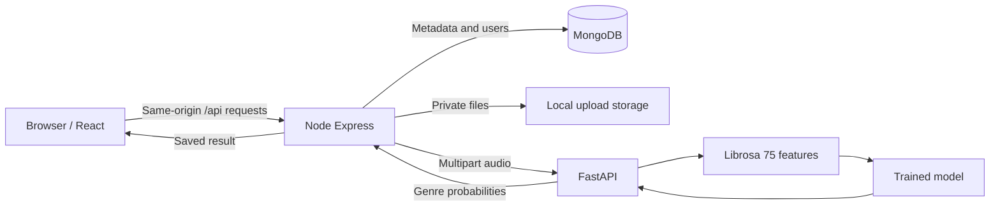

# Architecture

Training is offline: GTZAN raw audio → audit/deduplication → shared feature extraction → group-disjoint train/validation/test split → RF and SVM fitting → validation F1 model selection → held-out test reporting → trusted joblib bundle → FastAPI loads at startup.

MongoDB users: `_id`, `username`, unique normalized `email`, `passwordHash` (not selected normally), `role`, timestamps. Predictions: `_id`, `userId` (indexed with createdAt), `originalFileName`, `storedFileName` (private), audioDuration, analyzedDuration, audioFormat, predictedGenre, confidenceScore, probabilities (map), modelVersion and timestamps. Audio bytes are not in MongoDB. A user owns many predictions. History and audio endpoints check ownership before returning data.

The local file storage key is the random stored filename; no client-provided path is accepted. MongoDB and files are separate resources: the implementation cleans up on failed prediction and attempts cleanup on deletion. A process crash or disk failure can still leave orphan files; production needs reconciliation.
